

  <!-- ROCAMAN 3D Logo Banner -->
  

    

  <!-- Monocraft Typography Animated Subtitle -->
  

  <!-- Makapaka Roaming Easter Egg (Appears randomly across different spots) -->
  

  <!-- Interactive Minecraft Hotbar flanked by Rocaman Chibi & Axolotl -->
  

    <a href="https://rocaman.vercel.app/" title="Rocaman">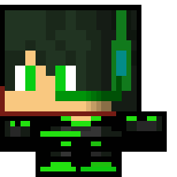</a>
    &nbsp;&nbsp;&nbsp;
    <a href="https://rocaman.vercel.app/" title="Rocaman Web (rocaman.vercel.app)">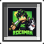</a><a href="https://rocastore.vercel.app/" title="RocaStore (rocastore.vercel.app)">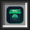</a><a href="https://rocafy.vercel.app/" title="Rocafy (rocafy.vercel.app)">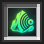</a><a href="https://ziroka.vercel.app/" title="Ziroka (ziroka.vercel.app)">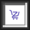</a><a href="https://impostor-rc.vercel.app/" title="Impostor (impostor-rc.vercel.app)">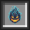</a><a href="https://cartas-rc.vercel.app/" title="Cartas Mus (cartas-rc.vercel.app)">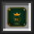</a><a href="https://misma-neurona-rc.vercel.app/" title="Misma Neurona (misma-neurona-rc.vercel.app)">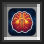</a><a href="https://marvel-rc.vercel.app/" title="Marvel RC (marvel-rc.vercel.app)">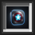</a><a href="https://rocalinks.vercel.app/" title="RocaLinks (rocalinks.vercel.app)">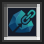</a>
    &nbsp;&nbsp;&nbsp;
    
  

 

---

### 📦 Proyectos y Aplicaciones

<table>
  <tr>
    <td align="center" width="50%" valign="top">
       
      <a href="https://rocastore.vercel.app/">
        
          
        <b>RocaStore</b>
      </a>
      
Tienda oficial de aplicaciones Android y web con instalación invisible sin residuos.

      <a href="https://rocastore.vercel.app/">
        <b>Abrir RocaStore ↗</b>
      </a>
        
    </td>
    <td align="center" width="50%" valign="top">
       
      <a href="https://ziroka.vercel.app/">
        
          
        <b>Ziroka</b>
      </a>
      
Gestor colaborativo de despensa y listas en tiempo real con asistente IA.

      <a href="https://ziroka.vercel.app/">
        <b>Abrir Ziroka ↗</b>
      </a>
        
    </td>
  </tr>
  <tr>
    <td align="center" width="50%" valign="top">
       
      <a href="https://rocaman.vercel.app/">
        
          
        <b>Rocaman Web</b>
      </a>
      
Portal web central con herramientas interactivas y recursos comunitarios.

      <a href="https://rocaman.vercel.app/">
        <b>Visitar web oficial ↗</b>
      </a>
        
    </td>
    <td align="center" width="50%" valign="top">
       
      <a href="https://rocafy.vercel.app/">
        
          
        <b>Rocafy</b>
      </a>
      
Plataforma de reproducción y streaming musical sin anuncios.

      <a href="https://rocafy.vercel.app/">
        <b>Escuchar en Rocafy ↗</b>
      </a>
        
    </td>
  </tr>
  <tr>
    <td align="center" width="50%" valign="top">
       
      <a href="https://github.com/RocamanMC/rocastore-apks/releases/latest/download/RocaSticker.apk">
        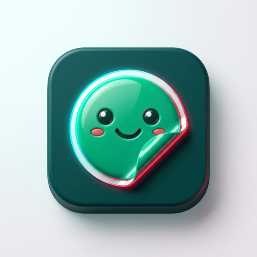
          
        <b>RocaSticker</b>
      </a>
      
Convierte vídeos de TikTok en stickers, gestiona tus propios paquetes y diseña stickers animados o estáticos desde cero para WhatsApp.

      <a href="https://github.com/RocamanMC/rocastore-apks/releases/latest/download/RocaSticker.apk">
        <b>⬇️ Descargar RocaSticker.apk</b>
      </a>
       
      v1.185 Oficial para Android
        
    </td>
    <td align="center" width="50%" valign="top">
       
      <a href="https://github.com/RocamanMC/AlwaysRotate">
        
          
        <b>AlwaysRotate</b>
      </a>
      
Rotación dinámica en tiempo real (60/120 FPS) con reenvío de clics para videollamadas y streaming.

      <a href="https://github.com/RocamanMC/AlwaysRotate/releases/latest">
        <b>Descargar en GitHub ↗</b>
      </a>
       
      v3.4 Portable para PC
        
    </td>
  </tr>
</table>

 

<!-- Destacado de Descarga Directa RocaSticker con Rocaman Animado -->

  

    <a href="https://github.com/RocamanMC/rocastore-apks/releases/latest/download/RocaSticker.apk" title="Descargar RocaSticker APK para WhatsApp">
      
      &nbsp;&nbsp;
      <b>¡Saca stickers de TikTok, gestiona tus propios paquetes y créalos desde cero!</b>
      &nbsp;&nbsp;
      
        
      
    </a>
  

 

---

### 🏆 Desafíos Desbloqueados

  

    <a href="https://rocastore.vercel.app/" title="RocaStore"></a>
    &nbsp;&nbsp;
    <a href="https://rocafy.vercel.app/" title="Rocafy"></a>
      
    <a href="https://ziroka.vercel.app/" title="Ziroka"></a>
    &nbsp;&nbsp;
    <a href="https://rocaman.vercel.app/" title="Rocaman Web"></a>
  

 

<!-- Minirreproductor estilo Rocafy -->

  <a href="https://rocafy.vercel.app/">
    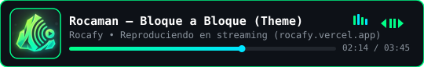
  </a>

 

---

### 🌐 Redes y Comunidad

  <!-- Minecraft Oak Hanging Sign -->
  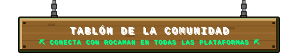

    

  <!-- Minecraft Oak Planks Notice Board -->
  

    <a href="https://www.youtube.com/@Rocaman_mc" title="YouTube Oficial de ROCAMAN">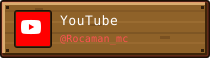</a>
    &nbsp;&nbsp;
    <a href="https://www.twitch.tv/rocaman_mc" title="Twitch Oficial de ROCAMAN">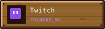</a>
    &nbsp;&nbsp;
    
      
    <a href="https://www.tiktok.com/@rocaman_mc" title="TikTok Oficial de ROCAMAN">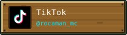</a>
    &nbsp;&nbsp;
    <a href="https://www.instagram.com/rocaman_mc" title="Instagram Oficial de ROCAMAN">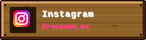</a>
    &nbsp;&nbsp;
    <a href="https://twitter.com/Rocaman_mc" title="X (Twitter) Oficial de ROCAMAN">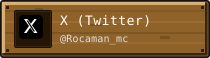</a>
  

 

<!-- Footer (Companions & Signature) -->

  
  &nbsp;&nbsp;&nbsp;&nbsp;
  
  &nbsp;&nbsp;&nbsp;&nbsp;
  
  &nbsp;&nbsp;&nbsp;&nbsp;
  
    
  Construido bloque a bloque por <b>Rocaman</b>

