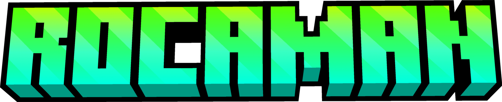
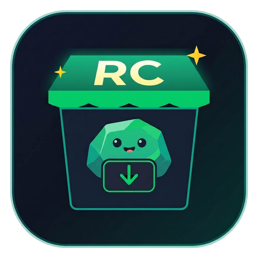
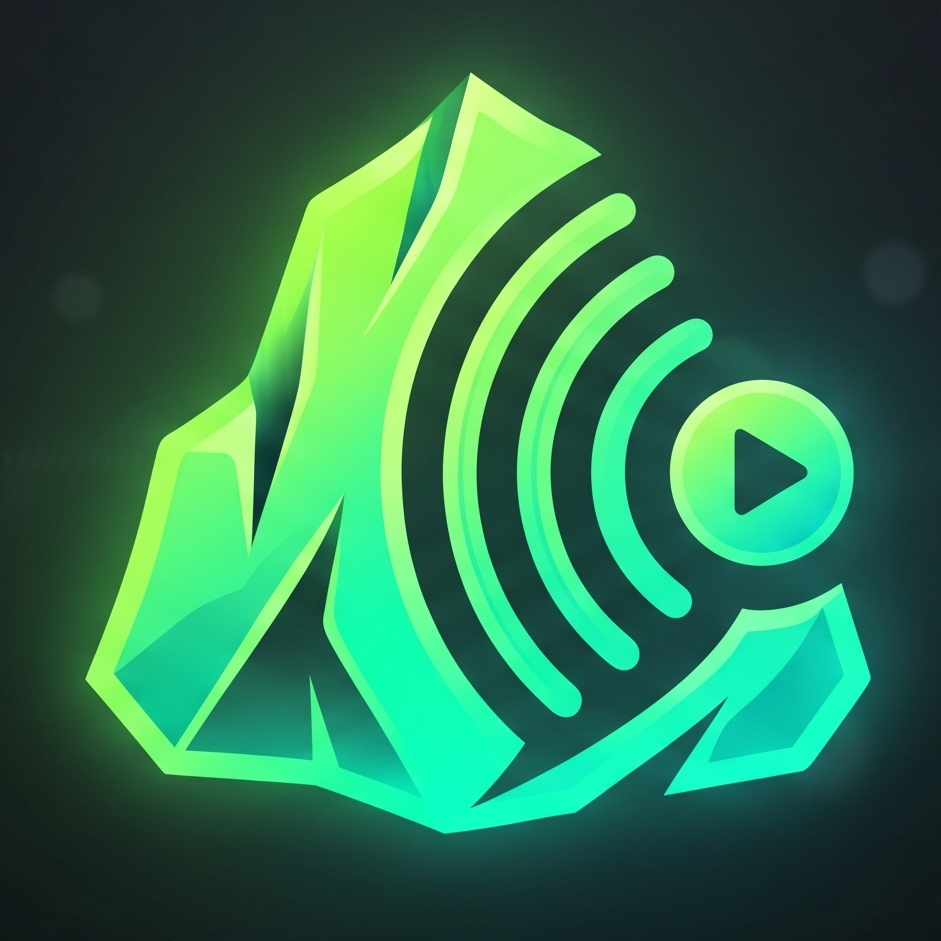
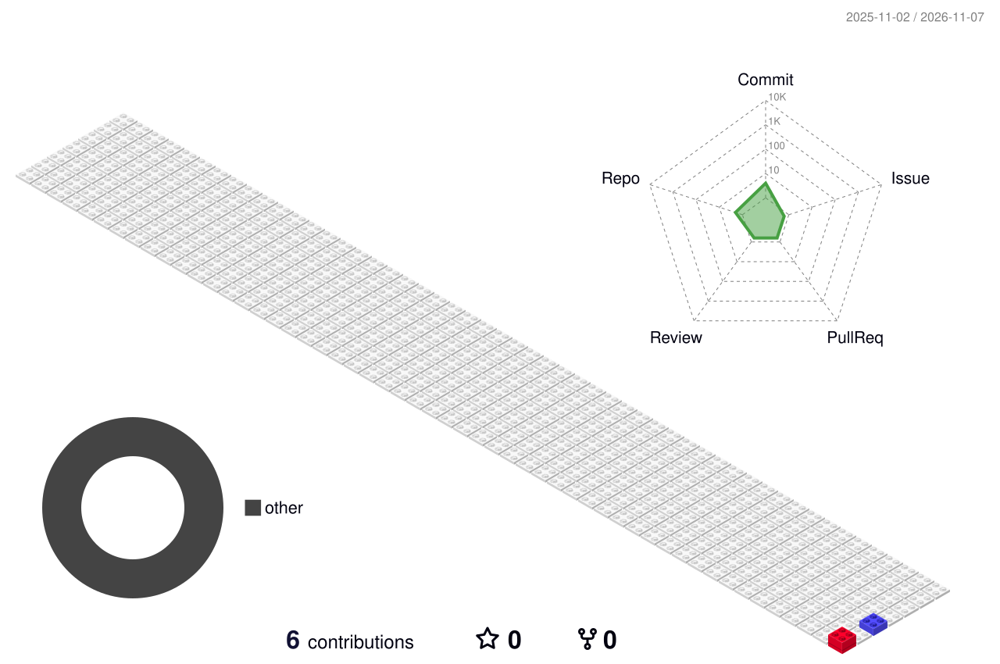

  <!-- ROCAMAN 3D Minecraft Style Banner -->
  

    

  <!-- Monocraft Typography Animated Subtitle -->
  

    

  <!-- Enlaces Directos Vercel -->
  
  &nbsp;
  
  &nbsp;
  
  &nbsp;
  

 

---

### 📦 Proyectos y Aplicaciones

<table>
  <tr>
    <td align="center" width="50%" valign="top">
       
      <a href="https://rocastore.vercel.app/">
        
         
        <b>RocaStore</b>
      </a>
      
Tienda oficial de aplicaciones Android y web con instalación invisible sin residuos.

      
        
    </td>
    <td align="center" width="50%" valign="top">
       
      <a href="https://ziroka.vercel.app/">
        
         
        <b>Ziroka</b>
      </a>
      
Gestor colaborativo de despensa y listas en tiempo real con asistente IA.

      
        
    </td>
  </tr>
  <tr>
    <td align="center" width="50%" valign="top">
       
      <a href="https://rocaman.vercel.app/">
        
         
        <b>Rocaman Web</b>
      </a>
      
Portal web central con herramientas interactivas y recursos comunitarios.

      
        
    </td>
    <td align="center" width="50%" valign="top">
       
      <a href="https://roca-mp3.vercel.app/">
        
         
        <b>RocaMP3</b>
      </a>
      
Plataforma de reproducción y streaming musical sin anuncios.

      
        
    </td>
  </tr>
</table>

---

### 🧱 Bloques de Actividad

  

 

  Construido bloque a bloque por <b>Rocaman</b>

